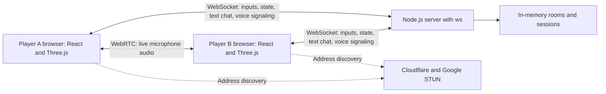

# Neon Rush 
 
A 3D action game built with React 19, TypeScript, Vite, React Three Fiber, and Three.js. Solo gameplay and Runner Lab render procedural models locally without external game assets or a backend. Online PvP uses the included Node WebSocket server.


## Run locally

Use Node.js 22.15 or newer.

```sh
cd neon-rush
npm install
npm run dev
```

Open the local URL Vite prints (default `http://127.0.0.1:5173`). Solo campaign and Runner Lab work with this command alone.

## Multiplayer

For 2-6 players: room codes, ready/start lobby, live combat, text chat, and two-way voice. Open **Multiplayer Arena**, create or join a room, and share the code. Everyone readies up before the host starts. Each player can enable their microphone for open-mic conversation; while muted, hold **V** or **TALK**. Tap **HEAR PLAYERS** if browser autoplay blocks voice.

With the frontend running from the quick-start above, start the backend in a second terminal from `neon-rush/`:

```sh
npm ci --prefix server
npm run server
```

Vite proxies `/ws` to the backend on port `3001`; no local `.env` is required. Check `http://127.0.0.1:3001/health`. For another frontend port or LAN hostname, set the backend's `ALLOWED_ORIGINS` to that exact origin, without a trailing slash.

### Architecture overview

Node.js and `ws` run the authoritative game server and room text chat. WebSockets also carry WebRTC setup messages; voice audio flows between browsers. Cloudflare and Google STUN help discover network addresses. Prediction, reconciliation, and interpolation smooth gameplay.



| Guide | Contents |
| --- | --- |
| [Developer architecture](neon-rush/docs/MULTIPLAYER-ARCHITECTURE.md) | Controls, room lifecycle, gameplay/chat/voice sequence diagrams, STUN/TURN, code map, and interview explanation |
| [Performance](neon-rush/docs/MULTIPLAYER-PERFORMANCE.md) | Timing configuration, diagnostics, benchmarks, and network tests |

## Interactive 3D Runner Lab

Use **Enter Runner Lab** below the game to rotate and zoom the articulated character, choose one of four armor finishes, preview every weapon, inspect its wireframe, and play Idle, Run, Jump, or Aim animations. Armor changes carry into gameplay and are saved locally. Opening the lab pauses an active run.

**Export 3D Model** downloads the selected character and four animations as a GLB. See the [Blender and Unreal workflow](neon-rush/docs/3D-WORKFLOW.md) for editing and import guidance. No native editor installation is needed to play or use the lab.

## Gameplay controls

| Action | Keyboard | Touch |
| --- | --- | --- |
| Change lane | Left / Right or A / D | Swipe left / right, or buttons |
| Jump | Up, W, Space | Swipe up, tap track, or Jump button |
| Slide / drop from jump | Down or S | Swipe down or Slide button |
| Pause / resume | Escape or P | Pause / Resume button |
| Start / retry | Enter | Start Run / Run It Back button |

Avoid tall pink blocks, jump orange barriers, and slide under raised pink beams. Each generated row leaves at least one lane clear. Speed gradually increases from 17 to 36 world units per second. Coins award 25 points and distance awards 2 points per meter.

- **Shield (cyan):** absorbs one collision; expires after 10 seconds.
- **Magnet (violet):** collects nearby coins across lanes for 12 seconds.
- **Double score (lime):** doubles distance and coin points for 10 seconds.

The game pauses on tab changes and lost window focus. Pausing freezes physics and power-up timers. Restart resets the run. Best score, sound, bloom, and reduced-motion preferences are stored locally, with graceful fallback if browser storage is unavailable. Reduced motion quiets ambient/menu animations; gameplay still moves. Sound is synthesized with Web Audio after user interaction. Mobile devices can disable bloom in Settings for better performance. WebGL / hardware acceleration is required; a fallback message appears if rendering fails.

## Solo code map

- `src/game/engine.ts` — rendering-independent simulation, obstacle generation, physics, collisions, score, and state snapshots.
- `src/game/audio.ts` — small Web Audio synthesizer.
- `src/game/useControls.ts` — keyboard input and automatic pause.
- `src/components/Scene.tsx` — city, track, animated runner, instanced obstacles and collectibles, camera, bloom.
- `src/components/Hud.tsx` — score, speed, power-up timers, and mobile controls.
- `src/components/GameOverlay.tsx` — start, countdown, pause, and game-over states.
- `src/components/Modal.tsx` — accessible native settings and instructions dialog.
- `src/App.tsx` — application layout, swipes, preferences, fullscreen, optional WebMCP read/pause integration.
- `src/styles.css` — responsive interface, reduced-motion styles, and transitions.

The simulation runs in bounded 1/120-second substeps to prevent collision tunneling. Mutable positions are updated directly by the render loop; UI snapshots publish at a lower rate. Instanced collectible and hazard meshes keep draw calls bounded. Simulation tests use a deterministic random source.

## Verification

```sh
npm test
npm run test:multiplayer
npm run build
```

`tests/engine.test.ts` checks state transitions, lane bounds, jumping/sliding, collisions, all power-ups, delayed frames, safe procedural rows, and difficulty. `scripts/browser-check.mjs` provides a Playwright browser smoke check when a Chromium executable is available; set `NEON_BROWSER` if it is not installed in Playwright's default location, then run it with the Vite server running.

The optional WebMCP integration is feature-detected and does nothing in ordinary browsers. A supported WebMCP host was unavailable during validation; standard browser gameplay was tested with Chromium.

## Deployment

Upload `neon-rush/dist/` to a static host after building; use `npm run preview` from `neon-rush/` to preview it locally. Follow the [Render deployment guide](neon-rush/docs/MULTIPLAYER-RENDER.md) for backend setup and connecting the frontend. Fonts use local system fallbacks if Google Fonts is unavailable.
