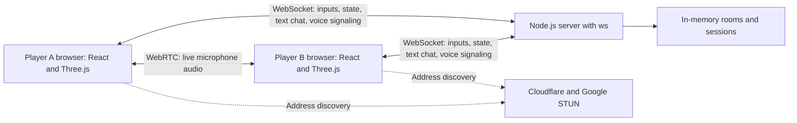
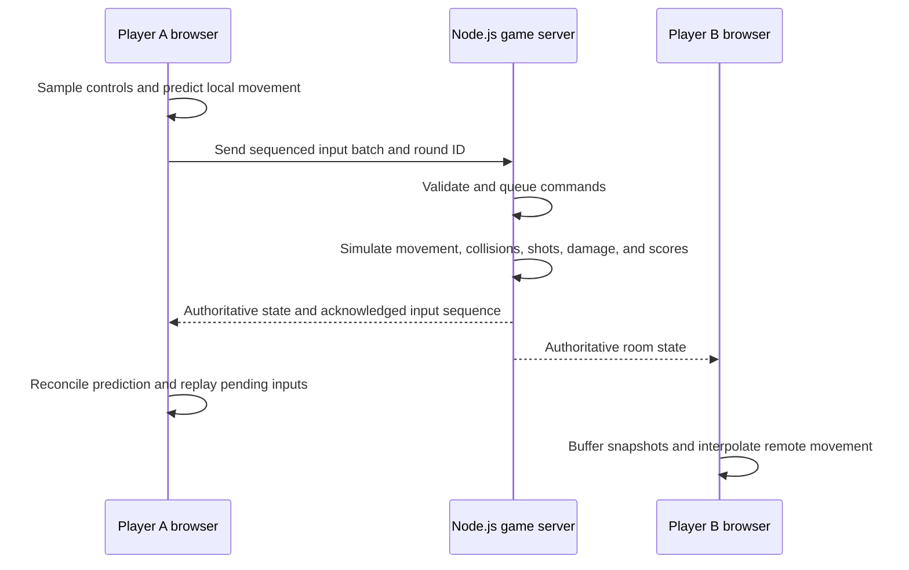
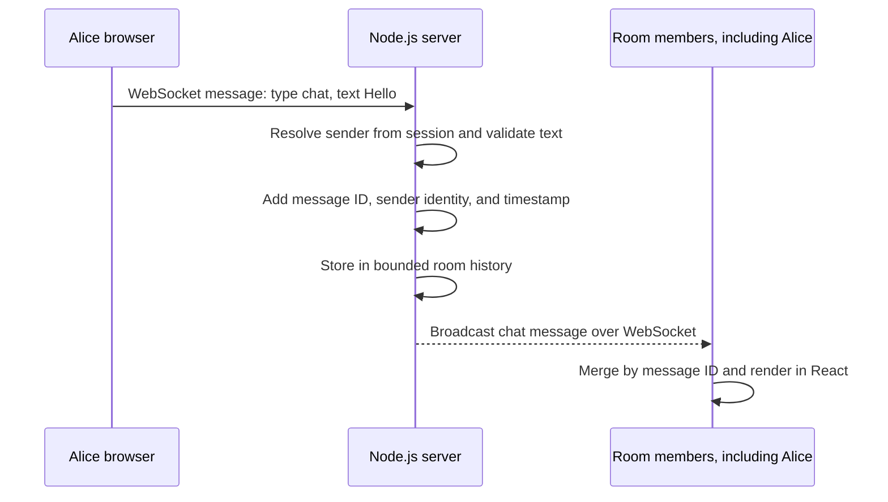
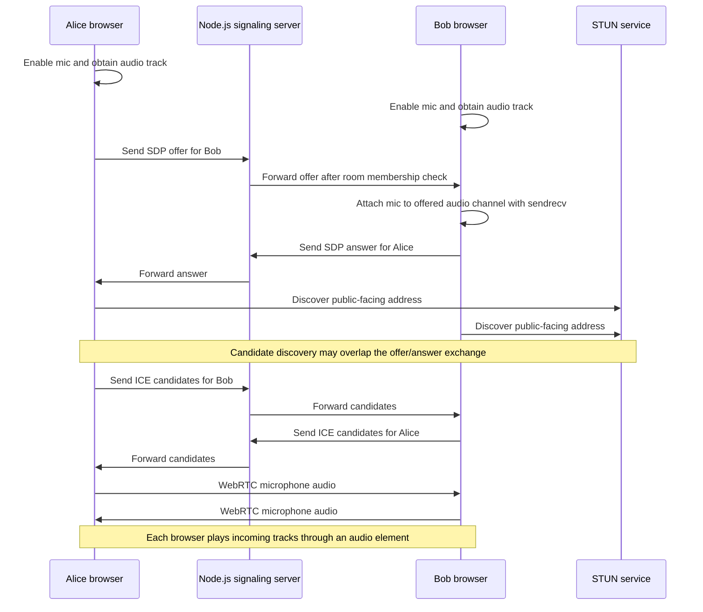

# Neon Rush 
 
A 3D action game built with React 19, TypeScript, Vite, React Three Fiber, and Three.js. Solo gameplay and Runner Lab render procedural models locally without external game assets or a backend. Online PvP uses the included Node WebSocket server.

## Run locally

Use Node.js 22.15 or newer.

```sh
cd neon-rush
npm install
npm run dev
```

Open the local URL Vite prints (default `http://127.0.0.1:5173`). Solo campaign and Runner Lab work with this command alone. To create and serve the production build:

```sh
npm run build
npm run preview
```

## Arena server setup

Online PvP and voice chat need the Node WebSocket server in a second terminal. From `neon-rush/`, install it once, then start both processes:

```sh
npm ci --prefix server
```

Terminal 1 — arena backend (port `3001`):

```sh
npm run server
```

Terminal 2 — game client:

```sh
npm run dev
```

Vite proxies `/ws` to `ws://127.0.0.1:3001`, so no `.env` file is required for local play. Open **Multiplayer Arena**, create or join a room, and share the six-character code. Confirm the backend with `http://127.0.0.1:3001/health` (`status: "ok"`).

If the client uses another port or a LAN hostname, set `ALLOWED_ORIGINS` on the server to that exact frontend origin (no trailing slash). The default allowlist includes `http://127.0.0.1:5173`, `http://localhost:5173`, and `http://127.0.0.1:5187`.

```sh
# PowerShell
$env:ALLOWED_ORIGINS="http://127.0.0.1:5173"; npm run server
```

For a local production preview, build with `VITE_MULTIPLAYER_URL=http://127.0.0.1:3001` and allow that preview origin on the backend.

```sh
npm run test:multiplayer
```

## Multiplayer arena

Multiplayer now includes local prediction/reconciliation, buffered remote rendering, configurable fixed server ticks, delta snapshots, and an optional F3 network overlay. See the [performance implementation and measured test results](neon-rush/docs/MULTIPLAYER-PERFORMANCE.md).

Choose **Multiplayer Arena**, enter a name, and create or join a room. Up to six friends can fight in the same 3D arena with live nameplates, health, radar, scores, respawns, rematches, room text chat, and voice chat. Keyboard/mouse and touch controls are supported. The server calculates movement, damage, and results. Type in **Room Chat** to message the lobby or match. For two-way voice, each player enables their microphone and grants permission once; the open mic lets players talk and listen simultaneously. When muted, hold **V** or **TALK** to speak temporarily. If browser autoplay blocks incoming audio, tap **HEAR PLAYERS**.

The production frontend can remain on Render Static Sites. Create the WebSocket backend manually as a separate Web Service and set the frontend's `VITE_MULTIPLAYER_URL` before rebuilding. Follow the [Render multiplayer deployment guide](neon-rush/docs/MULTIPLAYER-RENDER.md).

## Multiplayer architecture: developer walkthrough

### Stack and responsibilities

**The backend is Node.js.** It uses Node's built-in `node:http` module and the `ws` package, rather than Express or Socket.IO. The browser runs React and TypeScript for the interface, with Three.js and React Three Fiber for 3D rendering.

Three features share the room system but have different data paths:

| Feature | Transport | Responsibility |
| --- | --- | --- |
| Gameplay | WebSocket between each browser and Node.js | Server validates inputs, simulates the match, and distributes authoritative state |
| Text chat | The same WebSocket connection | Server validates messages and broadcasts them within the room |
| Voice setup (signaling) | The same WebSocket connection | Server forwards offers, answers, and network candidates between room members |
| Voice audio | WebRTC peer connections between browsers | Browsers capture, transmit, receive, and play microphone audio |
| Voice address discovery | STUN requests to Cloudflare and Google | Helps browsers discover network addresses they can try for a direct connection |



### Rooms, players, and the host

1. The browser opens a persistent WebSocket connection to the backend's `/ws` endpoint. In production, an HTTPS frontend uses secure WebSockets (`wss://`).
2. A `create` request makes a room with a six-character code. A `join` request adds a player to an existing room using that code.
3. The server generates each player's ID and reconnect token. The browser keeps the session in `sessionStorage` so a refresh can attempt to resume it.
4. The room host can request `start`, but the server checks host identity, room phase, and whether at least two players are connected and everyone is ready.
5. The server runs the countdown and match. The host is a player with extra permissions; their browser is not the game server.

Rooms and sessions are JavaScript `Map` objects in one Node.js process. Each room holds its own players, bullets, scores, phase, and chat history. Updates are routed to that room's members. A disconnected session has a default 20-second grace period to reconnect.

### Gameplay: authoritative server with responsive rendering

**Authoritative** means the Node.js server decides the real game state. Clients send input commands such as movement direction, aim, fire, dash, and reload. They cannot declare authoritative positions, damage, kills, or scores. The server validates commands and calculates the outcomes. This prevents several simple forms of cheating, but is not a complete anti-cheat system.

The default rates are separate because simulation, network traffic, and drawing have different jobs:

| Operation | Default | Meaning |
| --- | --- | --- |
| Local input commands and movement prediction | 60 steps/second | Respond immediately to the player's controls |
| Input batch transmission | Up to 30 messages/second | Send several sequenced commands together |
| Server simulation | 30 ticks/second | Advance the authoritative game using fixed time steps and 60 Hz substeps |
| Server snapshots | 15 updates/second | Send authoritative state to clients |
| Browser rendering | Device-dependent | Draw frames independently of network update frequency |

The server tick rate can be configured to 20, 30, or 60 Hz. A tick is a simulation update, not a rendered frame.



- **Client-side prediction:** move your own character immediately using shared movement rules, before the server reply arrives.
- **Server reconciliation:** reset to the server-confirmed state and replay commands the server has not acknowledged yet. For example, if commands 101–105 were predicted and the server acknowledges 103, replay 104 and 105. Small visual corrections are smoothed.
- **Interpolation:** keep a short buffer of timestamped snapshots and draw other players between known states, reducing visible network jitter.
- **Delta snapshots:** send changed fields rather than repeating every unchanged name, color, and other value. Each delta identifies its baseline; missing baselines trigger a resync. Joining, reconnecting, important transitions, and periodic keyframes use full snapshots.
- **Backpressure:** skip replaceable state updates when a socket queue grows, while preserving ordered control messages and events. Severely congested connections are closed so session recovery can obtain fresh state.

The server also rejects sequence gaps, ignores duplicate commands, bounds input queues, and checks round IDs. Sending more input messages cannot grant extra movement time. See the [performance implementation report](neon-rush/docs/MULTIPLAYER-PERFORMANCE.md) for exact timing and verification details.

### Text chat: room-scoped server broadcast



The server obtains the sender's identity from their connected session. A client cannot impersonate another player by including a different sender ID. Messages are limited to 80 characters, and each player must wait at least 400 ms between accepted messages. Each room retains the latest 80 messages in memory. Joining or reconnecting players receive `chat-history`; clients merge by ID to avoid duplicates.

There is no database-backed chat persistence. Room history disappears when the room is deleted or the server restarts.

### Voice chat: signaling first, audio second

Each player clicks **Enable Mic** and grants microphone permission. `getUserMedia()` returns a `MediaStream` containing an audio track, with echo cancellation, noise suppression, and automatic gain control requested. The browser creates an `RTCPeerConnection` for each other connected player.

WebRTC needs a setup exchange before audio can flow. This exchange is called **signaling**, and this project carries it through the existing Node.js WebSocket server. WebRTC does not prescribe a signaling transport.

| Term | Meaning |
| --- | --- |
| Offer | A browser's proposed media connection configuration |
| Answer | The other browser's compatible response |
| SDP | Session Description Protocol: describes media capabilities and connection settings |
| ICE candidate | A possible network address/path for reaching a peer |
| ICE | Interactive Connectivity Establishment: checks candidates to find a working path |
| Audio track | The microphone media sent through the negotiated connection |
| `sendrecv` | An audio channel that can send and receive simultaneously |



The server forwards voice setup messages only between members of the same room and validates their format and size. It does not receive, mix, or broadcast the actual voice audio in this design.

Player IDs deterministically choose the initial caller for each pair. The answerer reuses the audio channel created from the remote offer. Creating a separate, unnegotiated channel on the answerer caused the earlier one-way-audio bug. Both directions now use the negotiated `sendrecv` channel. Signaling messages are processed in order, and negotiation supports ICE restarts after connection failure.

An incoming WebRTC `track` event supplies the remote audio stream, which is attached to an HTML audio element. If autoplay is blocked, **HEAR PLAYERS** retries playback from a user gesture. Muting disables outgoing microphone audio while keeping incoming sound available. Deafening sets incoming voice volume to zero. An enabled, unmuted mic supports continuous two-way conversation; **V** and **TALK** provide optional push-to-talk while muted.

### What Cloudflare does here: STUN, NAT, and TURN

The voice configuration contains these public STUN endpoints:

```ts
const ICE_SERVERS = [
  { urls: 'stun:stun.cloudflare.com:3478' },
  { urls: 'stun:stun.l.google.com:19302' },
];
```

Most devices sit behind a router using **NAT (Network Address Translation)**. Their private local address is not directly reachable from the public Internet. A STUN request helps a browser discover the public-facing address and port associated with that request; ICE can then test whether a candidate path works between browsers. STUN discovery alone does not guarantee connectivity.

| Component | Purpose | Implemented here? |
| --- | --- | --- |
| STUN | Discover public-facing addresses to try for direct connections | Yes, Cloudflare and Google |
| TURN | Relay media when a direct connection cannot be established | No |
| SFU (Selective Forwarding Unit) | Receive and forward media streams for group calls | No |

**The Cloudflare endpoint is used for STUN address discovery. It is not hosting the Node.js game server or relaying the microphone audio in this implementation.** Restrictive NATs and firewalls can prevent direct voice connections; a production TURN relay would improve reliability on those networks.

References: [WebRTC peer connections and signaling](https://webrtc.org/getting-started/peer-connections), [Cloudflare STUN and connection patterns](https://developers.cloudflare.com/realtime/sfu/get-started/connection-patterns/).

### Scaling, limitations, and verification

Voice uses a **peer-to-peer mesh**. With six players, each browser has five peer connections, for 15 connections across the room. Browser upload and connection costs grow with room size; an SFU is a possible future design for larger groups.

The backend currently runs rooms in a single Node.js process with in-memory state. Restarting it loses rooms, sessions, and chat history. Scaling to multiple backend processes requires routing each room to its owning process or introducing coordination; adding replicas alone does not share the existing `Map` objects. TURN and an SFU are future infrastructure options, not existing features.

Gameplay verification includes simulation tests, real WebSocket tests, and a browser multiplayer check. The voice-specific [browser regression script](neon-rush/scripts/voice-browser-check.mjs) uses separate desktop and mobile-emulated browser contexts with fake microphones, checks received audio energy and playing audio elements in both directions, and exercises mute/unmute, push-to-talk, deafen/restore, simultaneous ICE restart, reconnect, and blocked playback recovery. These local browser checks do not prove connectivity on every real-world network or physical Android device.

### Interview explanation

> I built a browser multiplayer game using React, TypeScript, and Three.js, with a Node.js backend using the ws library. The server is authoritative: clients submit inputs, and the server calculates movement, combat, and scores. To keep movement responsive, the client predicts locally, reconciles against acknowledged server inputs, and interpolates remote players. Room text chat uses the same WebSocket connection. Voice uses WebRTC, with WebSocket signaling and Cloudflare and Google STUN services for network address discovery. The current system uses in-memory rooms and peer-to-peer voice for small groups; TURN support and room-aware scaling are future production improvements.

### Architecture code map

| File | Read it to understand |
| --- | --- |
| [server/index.mjs](neon-rush/server/index.mjs) | Node HTTP/WebSocket server, session binding, message routing, room broadcasts, signaling, and timers |
| [server/arena.mjs](neon-rush/server/arena.mjs) | Room rules, input validation, movement/combat simulation, readiness, scores, and chat history |
| [client.ts](neon-rush/src/multiplayer/client.ts) | WebSocket connection, input batches, reconnects, snapshot handling, text chat, and voice message dispatch |
| [simulation.ts](neon-rush/src/multiplayer/simulation.ts) | Local prediction, input replay, reconciliation, and buffered remote rendering |
| [voice.ts](neon-rush/src/multiplayer/voice.ts) | Microphone capture, peer connections, offers/answers, ICE, remote playback, and voice controls |
| [Multiplayer.tsx](neon-rush/src/multiplayer/Multiplayer.tsx) | Lobby, host actions, room chat, microphone controls, and match UI |
| [shared/movement.js](neon-rush/shared/movement.js) | Shared movement and collision rules used by client prediction and server simulation |
| [shared/snapshots.js](neon-rush/shared/snapshots.js) | Delta snapshot creation and baseline-checked application |

## Interactive 3D Runner Lab

Use **Enter Runner Lab** below the game to rotate and zoom the articulated character, choose one of four armor finishes, preview every weapon, inspect its wireframe, and play Idle, Run, Jump, or Aim animations. Armor changes carry into gameplay and are saved locally. Opening the lab pauses an active run.

**Export 3D Model** downloads the selected character and four animations as a GLB. See the [Blender and Unreal workflow](neon-rush/docs/3D-WORKFLOW.md) for editing and import guidance. No native editor installation is needed to play or use the lab.

## Gameplay controls

| Action | Keyboard | Touch |
| --- | --- | --- |
| Change lane | Left / Right or A / D | Swipe left / right, or buttons |
| Jump | Up, W, Space | Swipe up, tap track, or Jump button |
| Slide / drop from jump | Down or S | Swipe down or Slide button |
| Pause / resume | Escape or P | Pause / Resume button |
| Start / retry | Enter | Start Run / Run It Back button |

Avoid tall pink blocks, jump orange barriers, and slide under raised pink beams. Each generated row leaves at least one lane clear. Speed gradually increases from 17 to 36 world units per second. Coins award 25 points and distance awards 2 points per meter.

- **Shield (cyan):** absorbs one collision; expires after 10 seconds.
- **Magnet (violet):** collects nearby coins across lanes for 12 seconds.
- **Double score (lime):** doubles distance and coin points for 10 seconds.

The game pauses on tab changes and lost window focus. Pausing freezes physics and power-up timers. Restart resets the run. Best score, sound, bloom, and reduced-motion preferences are stored locally, with graceful fallback if browser storage is unavailable. Reduced motion quiets ambient/menu animations; gameplay still moves. Sound is synthesized with Web Audio after user interaction. Mobile devices can disable bloom in Settings for better performance. WebGL / hardware acceleration is required; a fallback message appears if rendering fails.

## Code map

- `src/game/engine.ts` — rendering-independent simulation, obstacle generation, physics, collisions, score, and state snapshots.
- `src/game/audio.ts` — small Web Audio synthesizer.
- `src/game/useControls.ts` — keyboard input and automatic pause.
- `src/components/Scene.tsx` — city, track, animated runner, instanced obstacles and collectibles, camera, bloom.
- `src/components/Hud.tsx` — score, speed, power-up timers, and mobile controls.
- `src/components/GameOverlay.tsx` — start, countdown, pause, and game-over states.
- `src/components/Modal.tsx` — accessible native settings and instructions dialog.
- `src/App.tsx` — application layout, swipes, preferences, fullscreen, optional WebMCP read/pause integration.
- `src/styles.css` — responsive interface, reduced-motion styles, and transitions.

The simulation runs in bounded 1/120-second substeps to prevent collision tunneling. Mutable positions are updated directly by the render loop; UI snapshots publish at a lower rate. Instanced collectible and hazard meshes keep draw calls bounded. Simulation tests use a deterministic random source.

## Verification

```sh
npm test
npm run build
```

`tests/engine.test.ts` checks state transitions, lane bounds, jumping/sliding, collisions, all power-ups, delayed frames, safe procedural rows, and difficulty. `scripts/browser-check.mjs` provides a Playwright browser smoke check when a Chromium executable is available; set `NEON_BROWSER` if it is not installed in Playwright's default location, then run it with the Vite server running.

The optional WebMCP integration is feature-detected and does nothing in ordinary browsers. A supported WebMCP host was unavailable during validation; standard browser gameplay was tested with Chromium.

## Deployment

Upload `neon-rush/dist/` to a static host after building. Create the multiplayer backend as a separate Node.js Web Service; see the [multiplayer deployment guide](neon-rush/docs/MULTIPLAYER-RENDER.md) for manual setup and connecting it to the existing Static Site. Fonts are optionally fetched from Google Fonts with local system fallbacks; gameplay does not depend on that request. No external game assets are loaded.
